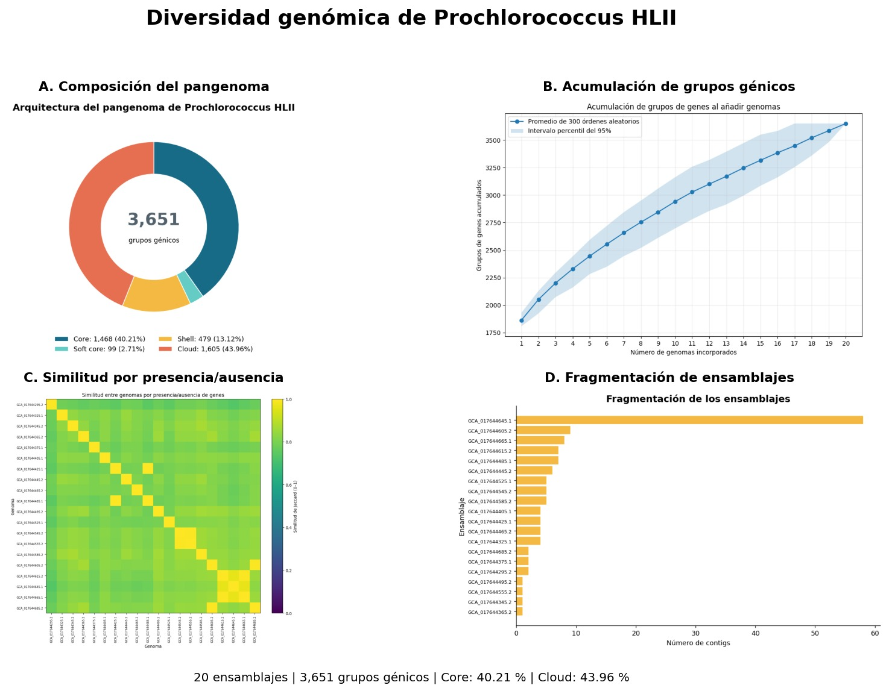
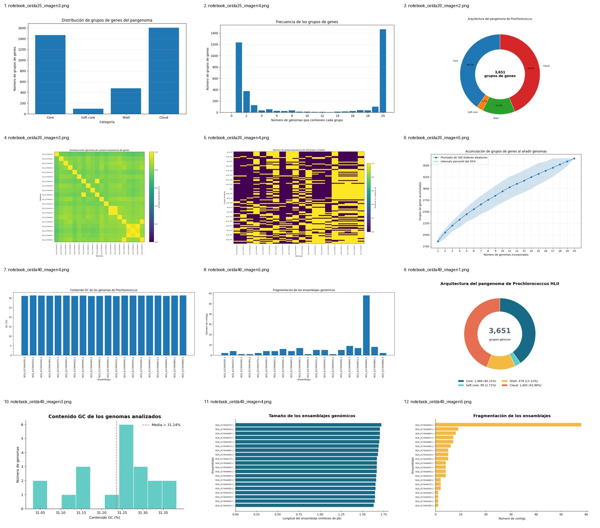

# 🧬 Diversidad genómica y pangenoma de *Prochlorococcus* HLII

**Proyecto de genómica ecológica y bioinformática**  
**Integrantes:** Alexa Glenn Lemus Tello y Pamela Valentina Hernández Vázquez



## Resumen

Se documenta un análisis comparativo de **20 ensamblajes genómicos públicos** asociados con *Prochlorococcus* HLII, recuperados de **NCBI**, para caracterizar la composición del pangenoma, la similitud entre repertorios génicos, la acumulación de grupos de genes y la fragmentación de los ensamblajes. El análisis del pangenoma se atribuye a **Panaroo**; se describen **Prokka** como herramienta de anotación y **R / Google Colab** como entornos de procesamiento y visualización, de acuerdo con el informe del proyecto.

## Pregunta de investigación

¿Cómo se distribuyen los grupos génicos conservados y variables entre 20 genomas de *Prochlorococcus* HLII y qué patrones de similitud y acumulación se observan al compararlos?

## Objetivo

Caracterizar la diversidad genómica de 20 genomas de *Prochlorococcus* HLII a partir de la composición del pangenoma y de patrones de presencia/ausencia génica.

## Procedimiento realizado / documentado

1. **Selección de datos públicos.** Se trabajó con 20 ensamblajes identificados mediante accesiones `GCA_...` de NCBI. La lista está en [`datos/accesiones_genomicas.csv`](datos/accesiones_genomicas.csv).
2. **Descripción de ensamblajes.** Se recopilaron longitud, contigs, N50 y GC para reconocer diferencias en continuidad y composición.
3. **Anotación.** El informe describe el uso de Prokka para generar anotaciones génicas. Los archivos originales de anotación no fueron incluidos en los materiales compartidos.
4. **Pangenoma.** Panaroo agrupó genes homólogos y produjo resultados de presencia/ausencia, resumidos en las categorías *core*, *soft core*, *shell* y *cloud*. La matriz original y el registro de parámetros no fueron adjuntados.
5. **Visualización.** Se generaron gráficas de composición del pangenoma, frecuencia, similitud de Jaccard, presencia/ausencia, acumulación y fragmentación.
6. **Interpretación ecológica.** Se analizaron patrones de conservación y variabilidad sin atribuir causalmente adaptación a genes concretos.

**Flujo:** NCBI → ensamblajes → anotación (Prokka) → pangenoma (Panaroo) → tablas/matriz → análisis y figuras (R/Colab).

## Resultados principales

| Categoría | Grupos génicos | Porcentaje |
|---|---:|---:|
| Core | 1,468 | 40.21 % |
| Soft core | 99 | 2.71 % |
| Shell | 479 | 13.12 % |
| Cloud | 1,605 | 43.96 % |
| **Total** | **3,651** | **100 %** |

El componente *cloud* (43.96 %) es ligeramente mayor que el *core* (40.21 %). Esto describe una combinación de grupos compartidos por todos los genomas y grupos de distribución restringida. No demuestra por sí mismo adaptación ecológica ni transferencia horizontal.

**Ensamblajes:** longitud media reportada de **1,674,372 pb**, media de **6.8 contigs**, N50 medio de **1,289,644.5 pb** y GC medio aproximado de **31.236 %**. El ensamblaje `GCA_017644645.1` fue reportado como el más fragmentado (**58 contigs**).

## Figuras



El panel principal integra: **A)** categorías del pangenoma, **B)** curva de acumulación (300 órdenes aleatorios reportados e intervalo del 95 %), **C)** similitud de Jaccard y **D)** número de contigs por ensamblaje. La galería conserva otras representaciones gráficas facilitadas por el equipo. Para analizar valores individuales de Jaccard y frecuencias se requiere la matriz original de Panaroo.

## ¿Por qué Panaroo y no Bactopia?

Se priorizó **Panaroo** porque la pregunta principal del proyecto era **comparar el repertorio de genes y caracterizar el pangenoma** a partir de ensamblajes y anotaciones. Panaroo está diseñado para agrupar genes entre genomas y depurar inconsistencias de anotación, y admite archivos GFF de herramientas como Prokka.

**Bactopia** es un flujo integral basado en Nextflow que puede abarcar recuperación de datos, control de calidad, ensamblaje, anotación y análisis adicionales, incluidos pangenomas mediante herramientas complementarias. No se utilizó como flujo principal porque el alcance del trabajo estaba concentrado en el pangenoma y se optó por una ruta más directa. **Esto no implica que Bactopia sea inadecuado o que no pueda trabajar con ensamblajes públicos**; de hecho, también puede utilizarlos. No se documentaron pruebas de rendimiento o fallas de Bactopia, por lo que no se afirma que se haya descartado por errores técnicos.

## Interpretación y limitaciones

- El índice de Jaccard mide similitud en presencia/ausencia, **no** reconstruye filogenia.
- La acumulación observada hasta 20 genomas no basta para declarar formalmente el pangenoma abierto o cerrado.
- Los ensamblajes fragmentados pueden influir en la detección de genes.
- Las categorías dependen de los umbrales y parámetros del análisis; sus valores exactos deben recuperarse del registro original.
- El material recibido contiene **figuras y un informe narrativo**, pero no la matriz de Panaroo, los GFF, el comando ejecutado ni las versiones de software. Por ello, el repositorio **documenta los resultados**, pero aún **no permite reproducir íntegramente el análisis original**.

## Estructura del repositorio

```text
├── README.md
├── datos/
│   ├── accesiones_genomicas.csv
│   ├── resumen_pangenoma.csv
│   └── resumen_ensamblajes.csv
├── figuras/
│   ├── panel_principal.png
│   └── galeria_resultados.png
├── notebooks/
│   ├── informe_proyecto.ipynb
│   └── informe_original.md
├── scripts/
│   └── graficas_resumen.R
└── referencias/
    └── fuentes.md
```

## Cómo explorar el proyecto

- Abre este `README.md` para la presentación principal.
- Consulta [`notebooks/informe_proyecto.ipynb`](notebooks/informe_proyecto.ipynb) para la descripción extensa, con metodología, interpretación y comentarios por figura.
- Abre [`datos/resumen_pangenoma.csv`](datos/resumen_pangenoma.csv) para los valores resumidos.
- Ejecuta `scripts/graficas_resumen.R` en RStudio **desde la carpeta raíz** para regenerar una gráfica de categorías usando la tabla resumida. Este script **no ejecuta Prokka ni Panaroo**.

## Próximos pasos para reproducibilidad

Añadir archivos de salida de Panaroo (`gene_presence_absence.csv` y/o matriz Rtab), GFF de anotación, parámetros, versiones, comandos y metadatos de los 20 ensamblajes. Verificar los cálculos y regenerar las figuras a partir de esos archivos.

## Fuentes

- [NCBI Assembly](https://www.ncbi.nlm.nih.gov/datasets/genome/)
- [Panaroo y documentación](https://github.com/gtonkinhill/panaroo)
- [Prokka](https://github.com/tseemann/prokka)
- [Bactopia](https://bactopia.io/)
- [R Project](https://www.r-project.org/)

**Créditos:** Alexa Glenn Lemus Tello y Pamela Valentina Hernández Vázquez. Datos genómicos públicos de NCBI; software de sus respectivos autores.
